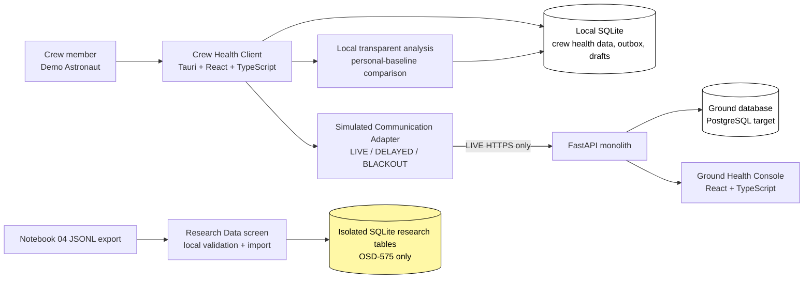
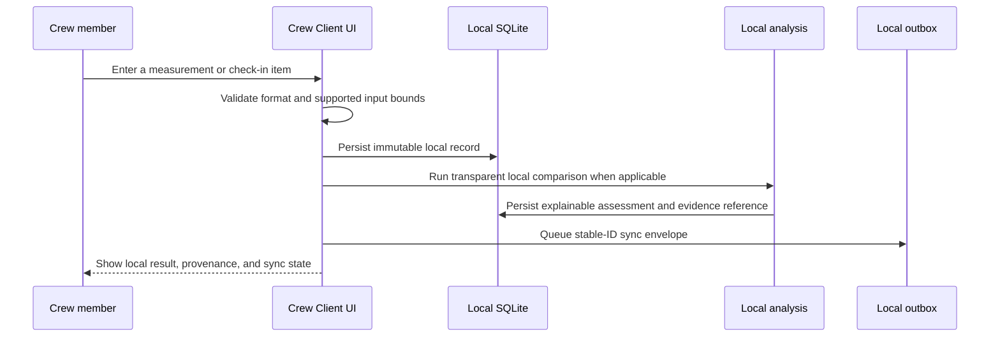
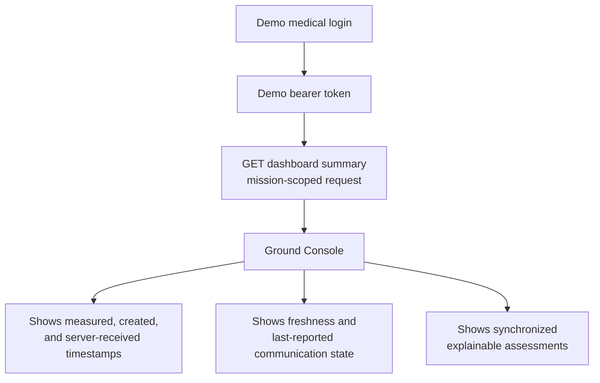
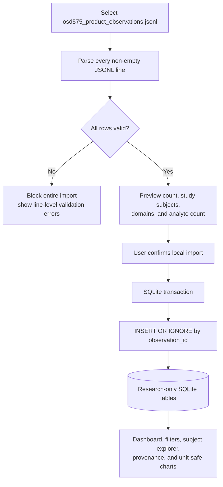
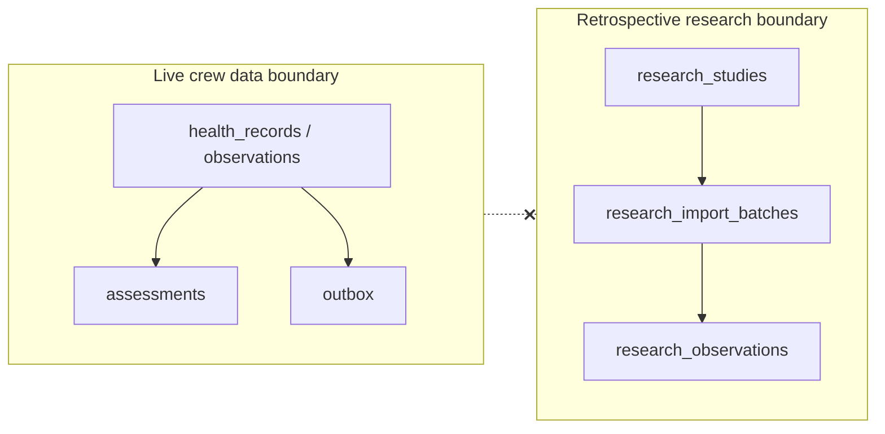

# Astronaut Health Monitoring & Decision-Support System

An offline-first health-monitoring demonstration with a local Crew Health Client, a Ground Health Console, and a simulated communication adapter. It is a hackathon prototype, not a medical diagnostic system, a flight-qualified system, or a NASA system.

**Specification version:** 0.3  
**Implementation status:** Crew Client, local SQLite persistence, baseline comparison, simulated synchronization, Ground Console retrieval, and isolated OSD-575 research-data import are implemented. See [Current implementation boundary](#current-implementation-boundary).  
**Research companion:** See [`docs/research/dataset-registry.md`](docs/research/dataset-registry.md) for candidate NASA and third-party datasets, rights, limitations, and approved-use warnings.

## Contents

- [What the system does](#what-the-system-does)
- [System architecture](#system-architecture)
- [Crew Health Client](#crew-health-client)
- [Ground Health Console and API](#ground-health-console-and-api)
- [Offline synchronization](#offline-synchronization)
- [Research Data: NASA OSD-575](#research-data-nasa-osd-575)
- [Storage and data boundaries](#storage-and-data-boundaries)
- [Run locally](#run-locally)
- [Test and build](#test-and-build)
- [Safety and limitations](#safety-and-limitations)
- [v0.3 reference specification](#v03-reference-specification)

## What the system does

The Crew Health Client is a Tauri desktop application built with React and TypeScript. It remains usable in simulated `BLACKOUT`, stores health observations locally in SQLite, performs a transparent personal-baseline comparison for heart-rate data, creates explainable assessments, and queues crew-originated events for later delivery.

The Ground Health Console is a React web application backed by one FastAPI service. It is intended for an authorized demo medical user to inspect synchronized synthetic crew records, their timestamps, data freshness, assessment summaries, and last-reported communication state.

The client also has an isolated Research Data area for retrospective NASA OSD-575 reference records. It is intentionally separate from mission observations: study subjects are never mapped to crew astronauts, relative study timepoints are never converted to UTC, and imported research records never produce crew alerts or medical conclusions.

## System architecture



The adapter is simulated. The project does not connect to NASA TDRS, DSN, spacecraft systems, or NASA infrastructure.

### Repository layout

| Path | Purpose |
|---|---|
| `apps/crew-client` | Tauri desktop Crew Health Client and its local SQLite integration. |
| `apps/ground-console` | Browser-based Ground Health Console. |
| `services/api` | Single FastAPI backend for demo authentication, synchronization, and ground retrieval. |
| `openapi.yaml` | Versioned API contract/reference. |
| `schema.sql` | Ground-side logical schema reference. |
| `crew-local-schema.sql` | Crew SQLite logical schema reference. |
| `docs/research/dataset-registry.md` | Dataset provenance, licensing, scope, and limitations. |

## Crew Health Client

The Crew Health Client is local-first. The app opens its SQLite store before enabling demo login, so a database failure is visible instead of silently falling back to browser storage.

### Available sections

| Area | Current behavior |
|---|---|
| Mission Dashboard | Local observation and assessment summary, communication state, pending count, and local trend view. |
| Daily Check-in | Six-step draftable workflow covering cardiovascular, recovery, behavioural, symptoms, activity, and nutrition/hydration inputs. |
| Health modules | Local entry, history, empty states, and unit-safe trend charts for cardiovascular, behavioural, sleep/cognition, musculoskeletal, immune, radiation, and environment data. |
| Sleep & Cognition | Persists reaction-time responses, median response time, and premature-response count locally. |
| Analytics | Filters local records by health domain, measurement, and 7-day/30-day/mission-history window. |
| Baselines | Shows the seeded demo heart-rate baseline and its version. |
| Action Centre | Persists evidence-linked action lifecycle changes locally; it does not generate medical recommendations. |
| Synchronization & Settings | Controls simulated connection state and optional synthetic demo data. |
| Research Data | Imports and visualizes isolated retrospective OSD-575 research data. |

### Crew data lifecycle



The prototype rejects structurally implausible demo input (for example, a 60-hour sleep duration or 24 °C body temperature). Those bounds are data-quality checks, not clinical reference ranges or medical thresholds.

## Ground Health Console and API

The Ground Console uses the API only after a demo medical login. Its dashboard displays synchronized data separately from source-time, client-creation-time, and server-receipt-time concepts.



The backend remains one FastAPI application. No microservice, message broker, or direct spacecraft integration is introduced.

## Offline synchronization

The Crew Client persists events before attempting transmission. An event keeps a stable ID and payload hash. A ground acknowledgement is required before the matching local record is shown as synchronized.

```mermaid
stateDiagram-v2
    [*] --> BLACKOUT
    BLACKOUT: Local capture and analysis continue
    BLACKOUT: No network request is attempted
    BLACKOUT --> DELAYED: Adapter state changed
    DELAYED: Records remain queued
    DELAYED --> LIVE: Transmission permitted
    LIVE: Authenticate and push queued envelopes
    LIVE --> LIVE: Accepted or duplicate acknowledgement
    LIVE --> DELAYED: Request fails; records stay queued
    LIVE --> BLACKOUT: Route unavailable
```



| State | Collection and analysis | Network behavior |
|---|---|---|
| `BLACKOUT` | Fully local and available. | No network attempt. |
| `DELAYED` | Fully local and available. | Records remain queued. |
| `LIVE` | Fully local and available. | Attempts push; marks only acknowledged event IDs as synchronized. |

## Research Data: NASA OSD-575

The Research Data screen accepts the Notebook 04 `osd575_product_observations.jsonl` export and imports it only after all non-empty JSONL lines validate. It uses local SQLite tables `research_studies`, `research_import_batches`, and `research_observations`; it never writes to live `observations`, astronauts, missions, baselines, alerts, or the crew outbox.



### Research safeguards

- Screen label: **NASA OSD-575 research reference data**.
- `subject_id` remains a pseudonymous study subject; it is never assigned to an astronaut or mission.
- `timepoint_text` is shown exactly as supplied. Labels such as `L-3` and `R+194` are not turned into timestamps.
- The research explorer performs only descriptive `L-` versus `R+` grouping when a selected subject/metric has compatible units. It creates no threshold, diagnosis, score, recommendation, or alert.
- Each displayed record retains value/unit, assay details, sample ID, source version, source file/table/sheet/row/column, upstream record ID, and quality status.
- Re-imports are idempotent by `observation_id` and show inserted versus duplicate-skipped counts.

## Storage and data boundaries



Local SQLite is active. SQLCipher encryption and OS-protected key storage are design targets only and must not be described as implemented or verified. Local browser storage is not used as a persistence substitute.

## Run locally

Use three PowerShell terminals from the repository root:

```powershell
# Terminal 1 — backend
cd D:\Projects\TakeOFF\astronaut_health_spec_v0_2\astronaut_health_spec\services\api
python -m pip install -r requirements.txt
python -m uvicorn app.main:app --reload --port 8000
```

```powershell
# Terminal 2 — Ground Health Console website
cd D:\Projects\TakeOFF\astronaut_health_spec_v0_2\astronaut_health_spec
npm install
npm run dev --workspace=ground-health-console
```

```powershell
# Terminal 3 — Crew Health Client desktop app
cd D:\Projects\TakeOFF\astronaut_health_spec_v0_2\astronaut_health_spec\apps\crew-client
npx tauri dev
```

The Ground Console’s Vite URL is printed in Terminal 2, normally `http://localhost:5173`. Start the API before switching the Crew Client to `LIVE`.

## Test and build

```powershell
cd D:\Projects\TakeOFF\astronaut_health_spec_v0_2\astronaut_health_spec
npm run test:ui
npm run build --workspace=crew-health-client
npm run build --workspace=ground-health-console
```

```powershell
cd D:\Projects\TakeOFF\astronaut_health_spec_v0_2\astronaut_health_spec\services\api
python -m pytest -q
```

```powershell
cd D:\Projects\TakeOFF\astronaut_health_spec_v0_2\astronaut_health_spec\apps\crew-client\src-tauri
cargo build
```

## Safety and limitations

- All demo health entries and optional seeded records must remain visibly labelled as synthetic where applicable.
- The app compares a supported heart-rate observation against one configured demo personal baseline. It does not diagnose, medically clear, prescribe, or predict outcomes.
- No validated machine-learning model, flight hardware integration, live sensor integration, SQLCipher deployment, production authentication, or flight assurance is claimed.
- Ground communication is a local simulated HTTP path. It is not proof of spacecraft contact or an operational communications link.
- Dataset availability and usage rights remain subject to the limitations in the dataset registry.

---

## v0.3 reference specification

The remainder of this README preserves the complete v0.3 data dictionary, API contract, synchronization rules, database design, and research constraints.

---

## 1. Product boundary

The system collects astronaut-specific observations from wearables, environmental sensors, periodic medical tests, cognitive tasks, and manual self-reports. It validates and stores observations, compares suitable measurements with an astronaut's personal baseline, runs domain-specific analysis, combines the resulting assessments, and presents evidence-based status information and next steps drawn from approved or clearly labelled demonstration protocols.

### 1.1 Dual-client architecture

The product has two clients over one versioned data model and synchronization protocol:

| Component | Form | Responsibility | Connectivity behaviour |
|---|---|---|---|
| **Crew Health Client** | Installable React + TypeScript desktop app packaged with Tauri | Local health records, manual entry, local analysis, local device adapters, outbox/inbox | Fully usable offline; SQLite is its source of truth. |
| **Ground Health Console** | Hosted React + TypeScript web app | Authorized medical review, freshness/alert/comms dashboard, messages and versioned updates to crew | FastAPI + PostgreSQL backend; mission-scoped authorization and audit. |
| **Communication Adapter** | Crew-client interface with simulated hackathon transport | Moves sync envelopes between the local client and gateway/backend | Reports `LIVE`, `DELAYED`, or `BLACKOUT`. |

```text
Crew devices -> local device adapters -> Tauri/React Crew Client -> SQLite (SQLCipher target; not verified)
                                                    | outbox / inbox
                                      Communication Adapter (simulated)
                                                    | HTTPS sync when available
                                                    v
Ground Console (React) -> FastAPI monolith -> PostgreSQL
```

The adapter is an abstract gateway boundary. This hackathon uses simulated transport only and must never claim direct access to NASA TDRS, DSN, a spacecraft, or NASA infrastructure. `LIVE` means the simulated endpoint is reachable, not that a flight link exists. `DELAYED` means transfer/acknowledgement is pending or stale; `BLACKOUT` means no usable route. Capture and analysis continue in every state. React UI packages may share presentation and contract components, while desktop and web retain separate shells and security contexts. Use one FastAPI application and one PostgreSQL database; no microservices or broker are required. Local database encryption is a target design, not a verified implemented property.

### 1.2 Core principles

1. **Personal baseline first.** Compare measurements with the astronaut's own baseline where one exists. Population reference ranges may be displayed only with their source and context; they do not replace individual baselines.
2. **Separate measurement from interpretation.** Store raw observations independently of assessments, alerts, and recommendations.
3. **Quality before risk.** Invalid, stale, missing, or low-quality readings should create data-quality states, not health alarms.
4. **No unsupported diagnosis.** The application identifies deviations and supports follow-up. It must not claim to diagnose a disease or infer injury from exposure alone.
5. **Preserve provenance.** Every observation records its timestamp, source, unit, device or manual-entry origin, quality metadata, and whether it is simulated.
6. **Fail safely.** Serious configured single-parameter escalation rules must not be suppressed because other domains look normal. When evidence is insufficient, say so.
7. **Offline-first crew operations.** Local capture, history, baselines, analysis, alerts, and device integration do not depend on the backend.
8. **Explicit synchronization.** Preserve event IDs, source timestamps, server receipt timestamps, sync state, retries, acknowledgements, and conflict outcomes. Never silently overwrite health records.
9. **Least privilege.** Ground access is limited to authorized medical personnel, scoped to mission/crew assignment, and audited.

### 1.3 Explicit MVP boundary

### MVP implementation cutline

**Must work for the demonstration (P0):**

- Installable Tauri crew shell; the complete crew data-capture and analysis flow runs without network access.
- SQLite local store backed by SQLCipher; release gate: complete the SQLCipher/key lifecycle checks in Section 6 before claiming it is encrypted.
- One seeded astronaut/mission, measurement catalogue, manual/simulated heart-rate observation, a versioned personal baseline, and one deterministic local assessment.
- Outbox survives app restart and simulates BLACKOUT then LIVE. Push/pull uses idempotent event IDs, ordered cursor, and per-event acknowledgements.
- Ground console authenticates an assigned medical officer, shows the same observation/assessment with device time, client time, server receipt, data freshness, last-reported comm state, and contact recency.
- Ground officer sends one message/update; crew pulls it, stores lifecycle events locally, records read/receipt, and syncs those events back.
- Demo labels simulated records and simulated communications; no clinical threshold, diagnosis, or NASA-system access claim.

**Can be deferred (P1/P2):** other health domains and multidomain analytics, hardware drivers, streaming/WebSocket input, analytics beyond the vertical-slice rule, production identity federation, message signatures/priority escalation, automated backups/recovery, challenge-resource ingestion, and flight-qualified cybersecurity/medical assurance. Deferred endpoints/features must not be presented as implemented.

**P1 — useful extensions**
- Environmental readings (CO2, temperature, humidity, pressure).
- Laboratory-result entry for immune and musculoskeletal indicators.
- Simulated sensor stream over WebSocket.

**P2 — research extensions**
- More advanced anomaly-detection models, device-specific integrations, raw ECG/waveform analysis, omics workflows, and validated clinical protocols.

Do not delay the vertical slice to train models. Use one transparent, versioned demonstration rule. This specification supplies no clinical thresholds or treatment recommendations.

---

## 2. Shared vocabulary and status model

### 2.1 Health domains

| Domain code | Display label | Initial MVP coverage |
|---|---|---|
| `cardiovascular` | Cardiovascular | HR, resting HR, HRV-RMSSD, BP, SpO2 |
| `behavioural_cognitive` | Behavioural & Cognitive | Sleep, mood, stress, fatigue, reaction-time task |
| `immune` | Immune | CBC and selected inflammatory / immune laboratory results |
| `musculoskeletal` | Musculoskeletal | Bone biomarkers, strength, exercise adherence |
| `radiation` | Radiation | Absorbed dose, dose equivalent, dose rate, cumulative exposure |
| `environmental` | Environment | CO2, temperature, humidity, cabin pressure |
| `data_quality` | Data Quality | Validity, completeness, freshness, source quality |

### 2.2 Assessment statuses

Use the same status vocabulary for module assessments and integrated assessments:

| Status | Meaning |
|---|---|
| `normal` | No configured concern detected in the available, sufficiently reliable data. Does not mean the astronaut is medically cleared. |
| `monitor` | A trend or deviation should be observed or rechecked. |
| `attention` | Findings warrant a defined follow-up assessment or review. |
| `urgent` | A configured, approved escalation rule has fired. Show the relevant emergency/medical protocol; do not delay escalation for model output. |
| `insufficient_data` | There is not enough recent or reliable data to assess the domain. |
| `data_quality_issue` | Data is invalid, stale, contradictory, or of insufficient quality. |

`normal` must never be used when a required measurement is missing or when its quality is inadequate; use `insufficient_data` or `data_quality_issue` instead.

### 2.3 Alert severity and lifecycle

Severity: `info`, `low`, `moderate`, `high`, `critical`.  
Lifecycle: `open`, `acknowledged`, `resolved`, `dismissed`.

An acknowledgement means the alert was seen. It does not mean the underlying issue is resolved.

---

# 3. Data dictionary

## 3.1 Observation envelope — required fields for every observation

Every input source must be converted to this common record before analysis.

| Field | Type | Required | Description / rule |
|---|---|---:|---|
| `observation_id` | UUID | Crew client | Client-generated immutable ID, created before local persistence and preserved by ground. |
| `astronaut_id` | UUID | Yes | Astronaut to whom the measurement belongs. |
| `mission_id` | UUID | Yes | Mission context. Must match an astronaut-mission assignment. |
| `measurement_code` | String | Yes | Stable code from the measurement catalogue. |
| `value` | Number / string / object | Yes | Observed value. Numeric measurements must be numeric, not numeric-looking text. |
| `unit` | String | Conditional | Required for unit-bearing measurements; must be supported for the measurement code. |
| `measured_at` | ISO-8601 timestamp | Yes | Time the measurement was taken, preferably UTC with `Z` or an explicit offset. |
| `received_at` | Timestamp | Server | Ground receipt time; absent locally until accepted by backend. |
| `created_at` | Timestamp | Client | Record creation time, distinct from `measured_at`. |
| `device_time_raw` | String / null | Source | Original device clock string/offset, retained without normalization loss. |
| `clock_quality` | Object | Client | `offset_estimate_ms`, `uncertainty_ms`, `reference_at`, and `method`; absent means unknown, not zero drift. |
| `sync_status` | Enum | Local | `local_only`, `queued`, `in_flight`, `synced`, `rejected`, `conflict`; local UI state. |
| `source.type` | Enum | Yes | `wearable`, `medical_device`, `laboratory`, `manual`, `environmental_sensor`, `dosimeter`, `cognitive_task`, `import`, `simulation`. |
| `source.device_id` | UUID / null | No | Registered device ID, where applicable. |
| `source.external_id` | String / null | No | Device-side event ID or external sample ID. |
| `quality.status` | Enum | Yes | `valid`, `questionable`, `invalid`, `unknown`. |
| `quality.score` | Number 0–1 / null | No | Optional source-specific quality score; not a medical confidence score. |
| `quality.details` | Object | No | Signal-quality details, reason for rejection, sensor flags, etc. |
| `context` | Object | No | Measurement-specific context, e.g. posture, exercise state, assay name, specimen type, test version. |
| `simulated` | Boolean | Yes | `true` for generated/demo data; must remain visible throughout the UI and exports. |
| `idempotency_key` | String | Recommended | Prevents duplicate ingestion when a device retries a request. |

### 3.2 Source and provenance rules

- A manual measurement must use `source.type = manual` and record the user/role in audit metadata.
- A laboratory result must include lab/test context where known: analyte, assay/platform, specimen type, collection time, result time, and laboratory-provided reference interval. Do not compare results from different assays as if they were automatically interchangeable.
- A derived value must be labelled as derived and retain references to the input observation IDs and calculation version.
- Simulated values must carry `simulated = true` at the observation, assessment, alert, and dashboard level.
- Do not silently overwrite an observation. Corrections should create a new observation or a traceable correction event.

The shared logical model is portable JSON with stable UUIDs and UTC ISO-8601 timestamps. SQLite and PostgreSQL use store-specific representations; database-native JSON/UUID types are not part of the wire contract.

### 3.2.1 Time and clock-drift semantics

- `measured_at` is the source/device-reported measurement time, normalized to UTC while retaining the raw source timestamp/offset and `clock_quality` metadata. It is not silently corrected.
- `created_at` is when the crew client persisted the record; `received_at` is when the ground API accepted it. These clocks are distinct and must be labelled separately in the UI.
- Every observation pins `catalogue_version`; its mission-scoped immutable catalogue snapshot determines the code/unit/source validation used when that record was accepted.
- When a trusted server-time sample is available, the client may estimate its local clock offset and uncertainty using the sample plus a monotonic elapsed-time source. Carry the estimate and reference time; do not treat it as exact.
- If offset uncertainty exceeds a configured demo tolerance or no trustworthy reference exists, mark clock quality `unknown`/`degraded`; retain the original timestamp and disclose that freshness is uncertain. Do not convert this into a health alert.
- Ground freshness shows both source age (based on `measured_at`, with clock-quality caveat) and arrival recency (based on `received_at`). Late arrival alone does not rewrite measurement time.

### 3.2.2 Synchronization event types and delivery rules

The protocol is bidirectional. Every item below is an explicitly supported `entity_type`. A push with an unknown type or unsupported schema version is rejected per event (`UNSUPPORTED_SCHEMA_VERSION`). On pull, a client that cannot apply an event stops before advancing its cursor, records the blocking event/version locally, and surfaces an update-required state; it must not skip the event and later apply dependent changes out of order.

| Entity type | Direction | Semantics |
|---|---|---|
| `observation` | Crew -> ground | Immutable source observation; corrections are new observation IDs with `correction_of`. |
| `device_registration` | Crew -> ground | Device descriptor only; sensitive raw device secrets are never synced. |
| `baseline_revision` | Crew -> ground | Immutable baseline version with exact method/window/sample provenance. |
| `analysis_run` | Crew/ground -> ground/crew | Completed synchronous run metadata, input snapshot hash, execution location and algorithm versions. |
| `module_assessment` | Crew/ground -> ground/crew | Immutable result and evidence references. |
| `integrated_assessment` | Crew/ground -> ground/crew | Immutable result with component assessment IDs. |
| `alert_event` | Crew/ground -> ground/crew | Append-only acknowledgement, resolution, or dismissal event; mutability uses expected revision. |
| `action_event` | Crew/ground -> ground/crew | Append-only action lifecycle event; current state is revisioned. |
| `crew_message` | Crew -> ground | Crew-originated message content, if enabled for the demo. |
| `message_lifecycle_event` | Both | Append-only transmitted/received/read/withdrawn event; persisted locally before enqueue. |
| `communication_status` | Crew -> ground | Latest adapter state and contact/push/pull timestamps with queued-event count; it is a report, not proof of a route or blackout. |
| `ground_message` | Ground -> crew | Authorized medical message or notification; delivery state is separate from creation. |
| `crew_update` | Ground -> crew | Versioned update sent by authorized medical personnel; prior versions remain auditable. |
| `protocol_version` | Ground -> crew | Versioned reference/configuration, with approval status and source. No local clinical rule is overwritten silently. |
| `measurement_catalogue_version` | Ground -> crew | Versioned measurement definitions and units. Existing observations retain their original catalogue version. |

Each envelope contains `event_id`, `entity_type`, `entity_id`, `operation` (`upsert`, `append_event`, or `revoke`), `schema_version`, `client_id`, `mission_id`, `actor_id`, `created_at`, `payload_hash`, optional `expected_revision`, and payload. `client_id` may be null only for a ground-originated feed event not addressed to a specific crew desktop. Health records and history are append-only. **Tombstones are not supported in v0.3**: hard deletion is prohibited for observations, assessments, messages, and audit history. `revoke` is an append-only lifecycle operation for explicitly revocable entities, with a reason and retained prior content; it never means physical deletion. An observation correction is a new observation; message withdrawal is a lifecycle event; catalogue/protocol retirement is a versioned change. A later retention policy may authorize physical purge outside sync.

`POST /sync/push` accepts only crew-originated event types; ground messages, crew updates, protocols and catalogue versions are created on the ground and delivered through pull. The server derives/validates `origin` and actor/client/mission scope from authentication rather than trusting client claims. It has per-client `batch_id` idempotency and per-event `event_id` idempotency. `payload_hash` is SHA-256 over canonical immutable event JSON (excluding `payload_hash` and transport headers): UTF-8, sorted object keys, normalized JSON numbers, and no insignificant whitespace. The batch hash covers the ordered canonical event list. Same ID plus same canonical payload hash returns the original acknowledgement. Reuse of either ID with a different payload hash is rejected as `ID_REUSE_MISMATCH`, emits an audit event, and never overwrites accepted content. An entity UUID already bound to different immutable content is also rejected. The client persists payload hash, event, retry count, and result until acknowledged.

The ground change feed is append-only and strictly ordered per mission by a transactional `sequence`. The writer increments `missions.change_seq` under row lock and appends the feed row in the same transaction; the lock is held through commit so later feed rows cannot commit ahead of earlier sequence numbers. `GET /sync/pull?cursor=...` takes an opaque, server-issued cursor scoped to client and mission, reads rows with sequence greater than its embedded last sequence, returns them in ascending order, and returns the last delivered sequence as the next cursor. A page with no events returns the input cursor. SQLite stores the cursor in `sync_state`, including when a page is empty. The client applies each `event_id` once and commits inbox changes and cursor together; retries after crash are safe. Authorization filters the feed to the client mission before returning changes.

Alerts/actions carry integer `revision`. An update must supply `expected_revision`; the server atomically updates only if it matches the current revision, increments the revision, appends its lifecycle/audit event, and publishes to the feed. A stale revision returns `409 REVISION_CONFLICT` with current revision/status. The client preserves the attempted action for authorized review; it never silently rebases or drops it.

Local message lifecycle events are persisted in SQLite before display/update or enqueue. A crew `read` acknowledgement is an outbox event and is retained through retry; message creation, transmission, crew receipt, read, withdrawal, and expiry have distinct timestamps/events.

The adapter reports the latest locally observed `state` (`LIVE`, `DELAYED`, `BLACKOUT`) with `state_observed_at`, `last_successful_contact_at`, `last_push_at`, `last_pull_at`, and queue count. The ground UI labels this as **last reported state as of [time]** and separately reports contact recency (`recent`, `stale`, `unknown`). Lack of a heartbeat never proves `BLACKOUT`; it only makes contact stale/unknown under a configured communications window. Health-data freshness is calculated separately from source and receipt timestamps.

## 3.3 Measurement catalogue — MVP and planned fields

The catalogue is the authoritative list of supported measurements. Codes are stable API identifiers. Units shown below are proposed canonical units; validate instrument/vendor conventions before ingesting real hardware.

### A. Cardiovascular

| Code | Display name | Value type | Canonical unit | Sources | MVP |
|---|---|---|---|---|---:|
| `heart_rate` | Heart rate | Numeric | `bpm` | wearable, medical_device, manual, simulation | P0 |
| `resting_heart_rate` | Resting heart rate | Numeric | `bpm` | wearable, manual, simulation | P0 |
| `hrv_rmssd` | HRV (RMSSD) | Numeric | `ms` | wearable, medical_device, manual, simulation | P0 |
| `systolic_bp` | Systolic blood pressure | Numeric | `mmHg` | medical_device, manual, simulation | P0 |
| `diastolic_bp` | Diastolic blood pressure | Numeric | `mmHg` | medical_device, manual, simulation | P0 |
| `spo2` | Peripheral oxygen saturation | Numeric | `%` | wearable, medical_device, manual, simulation | P1 |
| `body_temperature` | Body temperature | Numeric | `degC` | medical_device, manual, simulation | P1 |
| `heart_rate_recovery_60s` | Heart-rate recovery at 60 seconds | Numeric | `bpm` | wearable, medical_device, simulation | P1 |

HRV metrics are not interchangeable. If SDNN is added, create a separate code such as `hrv_sdnn`; do not store it under `hrv_rmssd`.

### B. Behavioural, sleep, and cognitive

| Code | Display name | Value type | Canonical unit | Sources | MVP |
|---|---|---|---|---|---:|
| `sleep_duration` | Total sleep duration | Numeric | `h` | wearable, manual, simulation | P0 |
| `sleep_efficiency` | Sleep efficiency | Numeric | `%` | wearable, manual, simulation | P1 |
| `wake_after_sleep_onset` | Wake after sleep onset | Numeric | `min` | wearable, manual, simulation | P1 |
| `sleep_interruptions` | Sleep interruptions | Numeric/count | `count` | wearable, manual, simulation | P1 |
| `mood_score` | Self-reported mood | Numeric | `score_0_10` | manual | P0 |
| `stress_score` | Self-reported stress | Numeric | `score_0_10` | manual | P0 |
| `fatigue_score` | Self-reported fatigue | Numeric | `score_0_10` | manual | P0 |
| `pain_score` | Self-reported pain | Numeric | `score_0_10` | manual | P1 |
| `pvt_mean_reaction_time` | Psychomotor vigilance mean reaction time | Numeric | `ms` | cognitive_task | P0 |
| `pvt_lapses` | Psychomotor vigilance lapses | Numeric/count | `count` | cognitive_task | P0 |
| `pvt_false_starts` | Psychomotor vigilance false starts | Numeric/count | `count` | cognitive_task | P1 |
| `physical_activity_minutes` | Physical activity duration | Numeric | `min` | wearable, manual, simulation | P1 |

For all `score_0_10` measurements, define the anchors in the UI and keep them consistent (e.g. 0 = none/very poor and 10 = extreme/very good as appropriate). Do not assume one direction fits every questionnaire. Store questionnaire/test instrument and version in `context`.

### C. Immune and inflammation — periodic clinical measurements

| Code | Display name | Value type | Canonical unit | Sources | MVP |
|---|---|---|---|---|---:|
| `wbc_count` | White blood cell count | Numeric | `10^9/L` | laboratory, manual, import | P1 |
| `lymphocyte_count` | Lymphocyte count | Numeric | `10^9/L` | laboratory, manual, import | P1 |
| `neutrophil_count` | Neutrophil count | Numeric | `10^9/L` | laboratory, manual, import | P1 |
| `crp` | C-reactive protein | Numeric | `mg/L` | laboratory, manual, import | P1 |
| `cytokine_result` | Cytokine assay result | Numeric | assay-specific | laboratory, manual, import | P2 |
| `infection_symptom_flag` | Infection-related symptom report | Object / categorical | `none_or_reported` | manual | P1 |

For cytokines, store the specific analyte (e.g. IL-6) and assay details in `context`; one generic code must not imply all cytokines share a unit or reference interval. CRP is an inflammation marker, not a standalone diagnosis of immune dysfunction.

### D. Musculoskeletal / bone / muscle — periodic clinical measurements

| Code | Display name | Value type | Canonical unit | Sources | MVP |
|---|---|---|---|---|---:|
| `ctx_bone_resorption` | CTX bone-resorption marker | Numeric | assay-specific | laboratory, manual, import | P1 |
| `p1np_bone_formation` | P1NP bone-formation marker | Numeric | assay-specific | laboratory, manual, import | P1 |
| `serum_calcium` | Serum calcium | Numeric | `mg/dL` | laboratory, manual, import | P1 |
| `25oh_vitamin_d` | 25-hydroxy vitamin D | Numeric | `ng/mL` | laboratory, manual, import | P1 |
| `grip_strength` | Grip strength | Numeric | `kgf` | medical_device, manual, simulation | P1 |
| `bone_mineral_density` | Bone mineral density | Numeric | `g/cm2` | medical_device, import | P2 |
| `resistance_exercise_minutes` | Resistance exercise duration | Numeric | `min` | manual, wearable, simulation | P1 |

CTX/P1NP assays can differ. Store assay platform, specimen, collection conditions, and lab-provided reference interval in `context`. Bone mineral density must come from an appropriate imaging/measurement method; do not infer it from a wearable.

### E. Radiation

| Code | Display name | Value type | Canonical unit | Sources | MVP |
|---|---|---|---|---|---:|
| `absorbed_dose` | Absorbed radiation dose | Numeric | `mGy` | dosimeter, import, simulation | P1 |
| `dose_equivalent` | Dose equivalent | Numeric | `mSv` | dosimeter, import, simulation | P0 |
| `dose_rate` | Dose-equivalent rate | Numeric | `uSv/h` | dosimeter, import, simulation | P1 |
| `linear_energy_transfer` | Linear energy transfer | Numeric | `keV/um` | dosimeter, import | P2 |

**Do not mix absorbed dose (Gy/mGy) and dose equivalent (Sv/mSv).** They represent different quantities. Cumulative exposure should be computed only from compatible measurements and instrument semantics; do not add a cumulative value to a stream that already reports cumulative totals. Record whether a device output is an increment, a rate, or a cumulative reading.

### F. Environmental

| Code | Display name | Value type | Canonical unit | Sources | MVP |
|---|---|---|---|---|---:|
| `cabin_co2` | Cabin carbon dioxide | Numeric | `ppm` | environmental_sensor, import, simulation | P1 |
| `cabin_temperature` | Cabin temperature | Numeric | `degC` | environmental_sensor, import, simulation | P1 |
| `relative_humidity` | Relative humidity | Numeric | `%` | environmental_sensor, import, simulation | P1 |
| `cabin_pressure` | Cabin pressure | Numeric | `kPa` | environmental_sensor, import, simulation | P1 |

### 3.4 Baseline data dictionary

A baseline is specific to one astronaut, one measurement code, and optionally one mission/context. It is not a universal threshold.

| Field | Type | Description |
|---|---|---|
| `measurement_code` | String | Measurement for which baseline is calculated. |
| `period_start`, `period_end` | Timestamp | Source data window used to calculate baseline. |
| `sample_count` | Integer | Number of valid observations used. |
| `mean`, `standard_deviation` | Numeric / null | Mean and standard deviation, where appropriate. |
| `median`, `mad` | Numeric / null | Robust location and median absolute deviation. |
| `canonical_unit` | String | Unit for all baseline statistics. |
| `method` | String | Versioned calculation method. |
| `status` | Enum | `provisional`, `active`, `retired`. |
| `version` | Integer | Increment when baseline is recalculated/approved. |

Do not calculate or activate a baseline from an arbitrary small number of observations. The minimum sample count and collection window should be measurement-specific and documented. For the demo, label short baselines as provisional.

---

# 4. Processing and analysis contract

## 4.1 Ingestion pipeline

`source -> parse -> validate -> normalize units -> quality checks -> persist observation -> trigger/recompute relevant module`

1. Resolve `measurement_code` against the catalogue.
2. Confirm astronaut/mission authorization and assignment.
3. Validate value type, supported unit, timestamp, source, and required context.
4. Normalize into the catalogue's canonical unit without discarding original value/unit.
5. Apply source-specific quality checks (range sanity checks are technical checks, not clinical diagnosis thresholds).
6. Persist the immutable observation with provenance and `simulated` flag.
7. Trigger analysis only when enough relevant data exists or a configured rule requires immediate evaluation.

## 4.2 Module input/output interface

Every module should implement a common interface conceptually equivalent to:

```python
assess(
    astronaut_id: UUID,
    mission_id: UUID,
    window_start: datetime,
    window_end: datetime,
    observations: list[Observation],
    baselines: list[Baseline],
    protocol_version: str | None
) -> ModuleAssessment
```

The implementation language may differ, but the output contract must remain stable.

### Module assessment output

The persisted API representation is the `ModuleAssessmentDetail` shape in `openapi.yaml`. Example:

```json
{
  "assessment_id": "00000000-0000-0000-0000-000000000091",
  "assessment_type": "module",
  "module_code": "cardiovascular",
  "status": "monitor",
  "assessed_at": "2026-11-14T08:35:00Z",
  "summary": "Selected cardiovascular measurements changed relative to this crew member's personal baseline.",
  "simulated": true,
  "algorithm_version": "demo-rules-0.3.0",
  "rule_set_version": "demo-config-0.3.0",
  "data_sufficiency": "sufficient",
  "evidence_observation_ids": ["45b0b64d-4f0b-4bc8-a4c0-faa55ed1d201"],
  "baseline_versions": [{"baseline_id":"cebcf1da-d92b-4cf2-8ad8-56f78c16f001","measurement_code":"resting_heart_rate","version":1}],
  "findings": [{
    "finding_code": "resting_hr_trend_increase",
    "measurement_code": "resting_heart_rate",
    "severity": "moderate",
    "direction": "increasing",
    "current_value": 76,
    "baseline_value": 61,
    "unit": "bpm",
    "evidence_observation_ids": ["45b0b64d-4f0b-4bc8-a4c0-faa55ed1d201"],
    "explanation": "Recent valid readings are above this crew member's established baseline."
  }],
  "limitations": ["Monitoring signal only; not a diagnosis."]
}
```

Integrated results have a separate discriminated response and are never serialized as a module result:

```json
{
  "assessment_id": "00000000-0000-0000-0000-000000000099",
  "assessment_type": "integrated",
  "status": "monitor",
  "assessed_at": "2026-11-14T08:35:00Z",
  "summary": "One or more domains warrant review.",
  "simulated": true,
  "algorithm_version": "demo-rules-0.3.0",
  "rule_set_version": "demo-config-0.3.0",
  "component_assessment_ids": ["00000000-0000-0000-0000-000000000091"],
  "uncertainty_notes": ["This prototype does not provide medical clearance."]
}
```

### Required module behaviour

- Return `insufficient_data` when required data or baseline is missing.
- Return `data_quality_issue` when relevant observations are invalid, stale, or too poor quality.
- Include the observation IDs supporting every finding.
- Include algorithm and rule-set versions for reproducibility.
- Do not emit a numeric disease probability unless it has been properly trained, calibrated, validated, and clearly labelled for its intended use.
- A module must not silently suppress an independent urgent protocol trigger.

## 4.5 Analysis execution and reproducibility

- Offline crew analysis executes in the packaged Crew Health Client on a fixed local input snapshot. Ground-requested analysis executes synchronously inside the FastAPI process against the ground-received snapshot. The ground browser does not calculate health results.
- Both implementations use the same versioned algorithm and rule-set specifications. A release may claim the same `algorithm_version` only after both implementations produce the same assessment outputs for the published conformance vectors. Record the implementation build separately.
- Every run persists `analysis_run_id`, requested actor/location, exact observation IDs and content snapshot hash, exact baseline IDs/versions, algorithm version, rule-set/protocol version, start/completion time, result IDs, and status. Assessments persist those references; no unversioned re-run overwrites an earlier result.
- A run request names its algorithm and rule-set versions. If a runtime does not have that exact version, it returns `409 ALGORITHM_VERSION_UNAVAILABLE`; it never silently substitutes a newer version. Integrated assessments include only module assessments with identical algorithm and rule-set versions. Incompatible saved assessments remain available, visibly version-labelled, but are not merged or directly compared.
- MVP runs are synchronous. A successful run returns `200` only after the `analysis_runs` and assessment rows commit together. An execution failure persists a failed `analysis_runs` row without assessments and returns a structured `500` failure response. No queue/`202` lifecycle is defined. The current API limit and bounded batch size keep the demonstration path small. If measured workloads later require background execution, add a persisted run state machine as a separately reviewed change.
- Reproduction means recomputing from the same immutable observations, exact baseline versions, algorithm/rule artifacts, protocol version, and input snapshot. Persist output hash and implementation build. Do not claim deterministic equivalence across builds until conformance validation has passed.

## 4.3 Multidomain integration

The integrator receives module assessments; it does not re-interpret raw data blindly and it must not simply average status labels.

It should:
1. Preserve every module status and finding.
2. Surface independent urgent triggers even if other domains are normal.
3. Identify co-occurring deviations as a **pattern for review**, not proof of causation.
4. Account for assessment freshness and data sufficiency.
5. Return an overall status plus domain-level detail and an explanation.

Recommended aggregation precedence for the MVP: `urgent` > `attention` > `monitor` > `normal`, while `insufficient_data` and `data_quality_issue` remain explicit domain states. If a critical domain is unassessable, the overall output must disclose that limitation rather than silently returning `normal`.

## 4.4 Recommendation/action contract

Every generated action must include:
- `action_type` (e.g. `repeat_measurement`, `complete_assessment`, `review_protocol`, `contact_medical_officer`, `informational`).
- A plain-language reason linked to a finding/alert.
- Source/protocol identifier and version, where available.
- Due time or timing guidance, where configured.
- Whether the item is a demo suggestion or an approved operational protocol.

Do not have a generative language model invent clinical advice. A language model may help rephrase an approved explanation, but the action itself must come from controlled rules/protocol content and be traceable.

---

# 5. API contract — REST `/api/v1`

All timestamps are ISO-8601. The server stores timestamps in UTC (`timestamptz`). All IDs are UUIDs. JSON uses `snake_case`.

## 5.1 General conventions

- `Content-Type: application/json`.
- Demo auth uses pre-seeded users and short-lived bearer tokens issued by `POST /auth/demo-token` in the single FastAPI service. Passwords are stored as salted password hashes; signed-token secrets are deployment configuration, never database seed values. Roles are `crew_member`, `medical_officer`, and `administrator`; every token is scoped to explicit mission IDs and (for crew) astronaut ID. This is demo authentication, not production identity assurance.
- `crew_member` reads/writes only their own crew record and message lifecycle. `medical_officer` reads assigned crew, acknowledges alerts, records action events, requests ground analysis, and sends messages/updates. `administrator` enrolls demo identities/devices and publishes catalogue/protocol versions; administrator does not gain health-record access by default.
- Crew-side offline access uses the locally provisioned astronaut/mission scope and OS user session. No offline role elevation or break-glass flow is defined. API authorization is rechecked against database mission assignment on each request.
- Validate that the authenticated user may access the astronaut and mission in every request.
- Use an `Idempotency-Key` header or `idempotency_key` field for retryable ingestion requests.
- Paginate collection endpoints with `limit` and `cursor` (or offset for the initial local demo); set a maximum page size.
- Return a consistent error object.
- Never return private health records to an unauthenticated client.
- Record authorization denials as audit events; never log message bodies, observation values, tokens, or database keys into general-purpose application logs.

### Standard error response

```json
{
  "error": {
    "code": "UNSUPPORTED_UNIT",
    "message": "Unit 'beats/minute' is not supported for measurement 'heart_rate'.",
    "details": {
      "measurement_code": "heart_rate",
      "supported_units": ["bpm"]
    },
    "request_id": "req_01J..."
  }
}
```

## 5.2 Endpoint summary

### Crew synchronization and communication

| Method | Path | Purpose |
|---|---|---|
| `POST` | `/sync/push` | Idempotently submit outbox events; return accepted, duplicate, rejected, or conflict results per event. |
| `GET` | `/sync/pull` | Pull authorized ground-originated changes after an opaque cursor (messages, updates, protocol/catalogue versions). |
| `GET` | `/sync/status` | Server view of last contact, pending acknowledgements, and sync health. |
| `GET` | `/communications/status` | Ground view of last contact, push/pull times, freshness, and pending count by crew client. |
| `GET` | `/messages` | List messages/updates for the authorized user or crew scope. |
| `POST` | `/messages` | Create an authorized ground-to-crew message/update with idempotency and audit identity. |
| `POST` | `/messages/{message_id}/events` | Record transmitted/received/read lifecycle acknowledgements. |
| `POST` | `/protocols/versions` | Administrator publishes a versioned protocol/configuration change into the crew feed. |
| `POST` | `/measurements/catalog/versions` | Administrator publishes a versioned catalogue change into the crew feed. |

Existing catalogue, observation, baseline, dashboard, analysis, assessment, alert, and action routes use the same model. Dashboard responses include measured/received times, age/freshness, adapter state, and last communication where available.

| Method | Path | Purpose | Priority |
|---|---|---|---|
| `GET` | `/measurements/catalog` | List supported measurements, units, domains, and source types | P0 |
| `POST` | `/auth/demo-token` | Exchange a pre-seeded demo identity for a short-lived scoped bearer token | P0 |
| `GET` | `/astronauts/{astronaut_id}` | Get astronaut profile | P0 |
| `GET` | `/missions/{mission_id}` | Get mission context | P0 |
| `POST` | `/observations` | Ingest one observation | P0 |
| `POST` | `/observations/batch` | Ingest multiple observations | P0 |
| `GET` | `/observations` | Query observations by astronaut, mission, code, and time range | P0 |
| `GET` | `/astronauts/{astronaut_id}/baselines` | List active/provisional baselines | P0 |
| `GET` | `/dashboard/summary` | Get current overview and latest assessments | P0 |
| `POST` | `/analysis/runs` | Run/re-run selected analysis modules | P0 |
| `POST` | `/sync/push` | Submit locally queued crew events idempotently | P0 |
| `GET` | `/sync/pull` | Pull ordered ground changes using an opaque client/mission cursor | P0 |
| `GET` | `/sync/status` | Report crew outbox and last successful contact status | P0 |
| `GET` | `/communications/status` | Show ground-side contact recency and data freshness | P0 |
| `GET` | `/messages` | List authorized ground messages and updates | P0 |
| `POST` | `/messages` | Send an authorized ground message/update to crew | P0 |
| `POST` | `/messages/{message_id}/events` | Record message lifecycle acknowledgement | P0 |
| `GET` | `/assessments` | List module/integrated assessments | P0 |
| `GET` | `/assessments/{assessment_id}` | Get assessment with findings and evidence | P0 |
| `GET` | `/alerts` | List alerts | P0 |
| `POST` | `/alerts/{alert_id}/acknowledgements` | Acknowledge an alert | P1 |
| `GET` | `/actions` | List recommended actions | P1 |
| `POST` | `/actions/{action_id}/events` | Record action started/completed/skipped | P1 |
| `POST` | `/protocols/versions` | Publish a versioned crew protocol/configuration reference | P1 |
| `POST` | `/measurements/catalog/versions` | Publish versioned catalogue changes | P1 |

## 5.3 Ingest one observation

`POST /api/v1/observations`

Request:

```json
{
  "observation_id": "45b0b64d-4f0b-4bc8-a4c0-faa55ed1d201",
  "astronaut_id": "8e8f4af7-3c2a-43f0-a1c0-8e89b2a0f101",
  "mission_id": "f8a8e5cb-50d4-4a3d-bb5e-95a4c2b7d102",
  "measurement_code": "resting_heart_rate",
  "catalogue_version": "demo-catalog-0.3.0",
  "value": 76,
  "unit": "bpm",
  "measured_at": "2026-11-14T08:30:00Z",
  "created_at": "2026-11-14T08:30:01Z",
  "source": {
    "type": "wearable",
    "device_id": null,
    "external_id": "watch-event-00017"
  },
  "quality": {
    "status": "valid",
    "score": 0.98,
    "details": {"wear_time_minutes": 30}
  },
  "context": {"posture": "seated", "rest_period_minutes": 10},
  "simulated": true,
  "idempotency_key": "demo-watch-event-00017"
}
```

Success `201 Created`:

```json
{
  "observation_id": "45b0b64d-4f0b-4bc8-a4c0-faa55ed1d201",
  "astronaut_id": "8e8f4af7-3c2a-43f0-a1c0-8e89b2a0f101",
  "mission_id": "f8a8e5cb-50d4-4a3d-bb5e-95a4c2b7d102",
  "measurement_code": "resting_heart_rate",
  "catalogue_version": "demo-catalog-0.3.0",
  "value": 76,
  "unit": "bpm",
  "canonical_value": 76,
  "canonical_unit": "bpm",
  "measured_at": "2026-11-14T08:30:00Z",
  "received_at": "2026-11-14T08:30:02Z",
  "quality_status": "valid",
  "simulated": true
}
```

Validation rules:
- Unknown measurement code: `422 UNKNOWN_MEASUREMENT`.
- Unsupported unit: `422 UNSUPPORTED_UNIT`.
- Wrong value type or impossible structure: `422 INVALID_VALUE`.
- Astronaut not assigned to mission: `403 MISSION_ACCESS_MISMATCH` (or a safe not-found response, depending on security policy).
- Duplicate idempotency key: return the previously accepted observation or `200` with the existing resource; do not create a duplicate.
- Invalid quality is stored only if useful for diagnostics; it must be excluded from health calculations and visibly marked.

## 5.4 Batch observation ingestion

`POST /api/v1/observations/batch`

Request:

```json
{
  "astronaut_id": "8e8f4af7-3c2a-43f0-a1c0-8e89b2a0f101",
  "mission_id": "f8a8e5cb-50d4-4a3d-bb5e-95a4c2b7d102",
  "observations": [
    {
      "observation_id": "00000000-0000-0000-0000-000000000011",
      "measurement_code": "heart_rate",
      "catalogue_version": "demo-catalog-0.3.0",
      "value": 72,
      "unit": "bpm",
      "measured_at": "2026-11-14T08:30:00Z",
      "created_at": "2026-11-14T08:30:01Z",
      "source": {"type": "simulation"},
      "quality": {"status": "valid"},
      "simulated": true,
      "idempotency_key": "sim-hr-001"
    },
    {
      "observation_id": "00000000-0000-0000-0000-000000000012",
      "measurement_code": "sleep_duration",
      "catalogue_version": "demo-catalog-0.3.0",
      "value": 5.8,
      "unit": "h",
      "measured_at": "2026-11-14T07:00:00Z",
      "created_at": "2026-11-14T07:00:01Z",
      "source": {"type": "manual"},
      "quality": {"status": "valid"},
      "simulated": true,
      "idempotency_key": "sim-sleep-001"
    }
  ]
}
```

Response `200 OK`:

```json
{
  "accepted_count": 2,
  "rejected_count": 0,
  "results": [
    {"index": 0, "status": "accepted", "observation_id": "00000000-0000-0000-0000-000000000011"},
    {"index": 1, "status": "accepted", "observation_id": "00000000-0000-0000-0000-000000000012"}
  ]
}
```

A batch response should report per-item failures so one bad reading does not hide the rest. Set a documented maximum batch size (e.g. 500 records for the MVP).

## 5.5 Query observations

`GET /api/v1/observations?astronaut_id={uuid}&mission_id={uuid}&measurement_code=resting_heart_rate&from=2026-11-01T00:00:00Z&to=2026-11-14T23:59:59Z&limit=100`

Response:

```json
{
  "items": [
    {
      "observation_id": "45b0b64d-4f0b-4bc8-a4c0-faa55ed1d201",
      "astronaut_id": "8e8f4af7-3c2a-43f0-a1c0-8e89b2a0f101",
      "mission_id": "f8a8e5cb-50d4-4a3d-bb5e-95a4c2b7d102",
      "measurement_code": "resting_heart_rate",
      "catalogue_version": "demo-catalog-0.3.0",
      "value": 76,
      "unit": "bpm",
      "measured_at": "2026-11-14T08:30:00Z",
      "received_at": "2026-11-14T08:30:02Z",
      "created_at": "2026-11-14T08:30:01Z",
      "source": {"type": "wearable"},
      "quality_status": "valid",
      "canonical_value": 76,
      "canonical_unit": "bpm",
      "simulated": true
    }
  ],
  "next_cursor": null
}
```

## 5.6 Get baselines

`GET /api/v1/astronauts/{astronaut_id}/baselines?mission_id={uuid}`

Response:

```json
{
  "items": [
    {
      "baseline_id": "cebcf1da-d92b-4cf2-8ad8-56f78c16f001",
      "astronaut_id": "8e8f4af7-3c2a-43f0-a1c0-8e89b2a0f101",
      "mission_id": null,
      "measurement_code": "resting_heart_rate",
      "status": "active",
      "method": "median_mad_v1",
      "period_start": "2026-10-01T00:00:00Z",
      "period_end": "2026-10-21T23:59:59Z",
      "sample_count": 18,
      "median": 61,
      "mad": 3,
      "mean": 62.1,
      "standard_deviation": 4.2,
      "unit": "bpm",
      "version": 1
    }
  ]
}
```

Baseline recalculation/activation should be a controlled backend or medical-officer operation, not a casual front-end write. Preserve prior baseline versions.

## 5.7 Run analysis

`POST /api/v1/analysis/runs`

Request:

```json
{
  "astronaut_id": "8e8f4af7-3c2a-43f0-a1c0-8e89b2a0f101",
  "mission_id": "f8a8e5cb-50d4-4a3d-bb5e-95a4c2b7d102",
  "window_start": "2026-11-07T00:00:00Z",
  "window_end": "2026-11-14T08:35:00Z",
  "modules": ["cardiovascular", "behavioural_cognitive", "radiation"],
  "include_integrated_assessment": true,
  "algorithm_version": "demo-rules-0.3.0",
  "rule_set_version": "demo-config-0.3.0"
}
```

Response `200 OK` after the run and assessments have committed:

```json
{
  "run_id": "e0f2b0e0-8e2b-4e3a-90f7-7b5a1f30c001",
  "status": "completed",
  "execution_location": "ground_backend",
  "algorithm_version": "demo-rules-0.3.0",
  "rule_set_version": "demo-config-0.3.0",
  "implementation_build": "ground-demo-build-0.3.0",
  "input_snapshot_hash": "aaaaaaaaaaaaaaaaaaaaaaaaaaaaaaaaaaaaaaaaaaaaaaaaaaaaaaaaaaaaaaaa",
  "completed_at": "2026-11-14T08:35:01Z",
  "module_assessment_ids": ["00000000-0000-0000-0000-000000000091", "00000000-0000-0000-0000-000000000092", "00000000-0000-0000-0000-000000000093"],
  "integrated_assessment_id": "00000000-0000-0000-0000-000000000099"
}
```

Do not accept arbitrary clinical thresholds from the client. Thresholds and rule sets must be versioned, controlled configuration.

## 5.8 Dashboard summary

`GET /api/v1/dashboard/summary?astronaut_id={uuid}&mission_id={uuid}`

Response:

```json
{
  "astronaut_id": "8e8f4af7-3c2a-43f0-a1c0-8e89b2a0f101",
  "mission_id": "f8a8e5cb-50d4-4a3d-bb5e-95a4c2b7d102",
  "mission_day": 120,
  "integrated_status": "monitor",
  "assessed_at": "2026-11-14T08:35:00Z",
  "domains": [
    {"module_code": "cardiovascular", "status": "monitor", "summary": "Selected measurements differ from baseline."},
    {"module_code": "behavioural_cognitive", "status": "attention", "summary": "Sleep and cognitive performance trends warrant follow-up."},
    {"module_code": "immune", "status": "insufficient_data", "summary": "No sufficiently recent laboratory result is available."},
    {"module_code": "radiation", "status": "normal", "summary": "No configured exposure alert in the current window."}
  ],
  "open_alert_count": 1,
  "pending_action_count": 2,
  "data_quality": {"status": "partial", "stale_measurement_count": 1},
  "simulated": true,
  "adapter_state": "LIVE",
  "adapter_state_observed_at": "2026-11-14T08:34:59Z",
  "contact_recency": "recent",
  "latest_measured_at": "2026-11-14T08:30:00Z",
  "latest_received_at": "2026-11-14T08:30:02Z",
  "freshness": "current"
}
```

The top-level `integrated_status` is a concise navigation aid; the domain statuses and data-sufficiency indicators must remain visible.

## 5.9 Alerts and acknowledgements

`GET /api/v1/alerts?astronaut_id={uuid}&status=open`

`POST /api/v1/alerts/{alert_id}/acknowledgements`

Request:

```json
{"note": "Reviewed; will repeat the measurement after rest.", "expected_revision": 1}
```

Response:

```json
{
  "alert_id": "00000000-0000-0000-0000-000000000088",
  "alert_code": "demo_baseline_change",
  "severity": "moderate",
  "title": "Baseline change",
  "message": "Selected readings differ from the personal baseline.",
  "status": "acknowledged",
  "created_at": "2026-11-14T08:35:00Z",
  "revision": 2
}
```

Acknowledgement is not resolution. Only an authorized workflow or explicit resolution event may resolve an alert.

## 5.10 Actions

`GET /api/v1/actions?astronaut_id={uuid}&status=pending`

`POST /api/v1/actions/{action_id}/events`

Request:

```json
{
  "event_type": "completed",
  "expected_revision": 1,
  "note": "Repeated the resting measurement; result saved as a new observation."
}
```

Allowed event types: `started`, `completed`, `skipped`, `deferred`, `cancelled`. Keep an append-only action event log.

---

# 6. Database design — SQLite locally and PostgreSQL on ground

`schema.sql` defines the ground PostgreSQL store. `crew-local-schema.sql` defines the Crew Health Client SQLite store and outbox/inbox. Both implement the same logical entities and wire contract; PostgreSQL adds authoritative receipt/audit and cross-client sync metadata. The application enforces mission membership, role authorization, protocol approval, and business rules. Local database encryption is a release requirement, not an implemented or verified property of these DDL files. The preferred design is a SQLCipher-enabled SQLite build with a random database key held in OS-protected credential storage (Windows Credential Manager for the current Windows demo target; platform-specific equivalent if the target expands). Never store key material beside SQLite. Local device integrations remain behind in-process adapters.

SQLCipher is not an ordinary SQLite extension that can be assumed present: the desktop package must be built and tested against the selected SQLCipher library. The app must fail closed when the encrypted database cannot be opened. Release checks must cover the main database, WAL/journal and temporary files, wrong-key rejection, key non-disclosure to logs/UI, and backup output. Do not describe encryption as implemented until these checks pass. Backups are outside the MVP; when added, create an encrypted consistent snapshot under the same database key. Restore requires the corresponding OS-protected key. Cross-device recovery/key escrow and rotation remain unresolved.

## 6.1 Entity relationship overview

```text
astronauts ----< astronaut_missions >---- missions
     |                                      |
     |                                      |
     +----< observations >---- measurement_definitions
     |             |
     |             +---- devices
     |
     +----< health_baselines >---- measurement_definitions
     |
     +----< module_assessments ----< assessment_findings
     |                 |
     |                 +----< assessment_inputs >---- observations
     |
     +----< integrated_assessments ----< integrated_assessment_components >---- module_assessments
     |                 |
     |                 +----< alerts ----< recommended_actions ----< action_events
     |
     +----< laboratory_results (future extension; MVP can store lab values as observations with specimen/assay context)
```

## 6.2 Core table responsibilities

| Table | Responsibility |
|---|---|
| `astronauts` | Minimal astronaut profile. Avoid unnecessary personal identifiers. |
| `missions` | Mission metadata and time bounds. |
| `astronaut_missions` | Assignment/participation relationship. |
| `app_users` / `user_mission_scopes` | Demo-only password hashes, roles, and explicit mission/optional astronaut scopes; no bearer tokens or signing secret are stored. |
| `measurement_definitions` | Canonical measurement catalogue and allowed units/source types. |
| `measurement_catalogue_versions` | Immutable mission-scoped catalogue snapshot; each observation records the exact catalogue version used for validation. |
| `devices` | Registered wearable, medical, environmental, and dosimetry devices. |
| `observations` | Immutable raw/normalized measurement records and provenance. |
| `health_baselines` | Versioned individual baseline statistics. |
| `protocols` | Versioned, approval-labelled protocol or demo rule references. |
| `module_assessments` | Result of an individual domain engine. |
| `assessment_findings` | Explainable individual findings and evidence. |
| `assessment_inputs` | Exact observations used in an assessment. |
| `assessment_baselines` | Exact baseline row and version used in an assessment; later revisions do not change historical evidence. |
| `analysis_runs` | Synchronous run provenance, immutable input snapshot hash, algorithm/rule versions, implementation build and resulting assessment IDs. |
| `integrated_assessments` | Combined multidomain interpretation. |
| `integrated_assessment_components` | Module outputs used by an integrated assessment. |
| `alerts` | Notifications generated from assessments. |
| `recommended_actions` | Traceable next-step tasks. |
| `action_events` | Append-only action history. |
| `alert_events` | Append-only alert lifecycle history. |
| `audit_events` | General actor/action/outcome audit record with optional mission, astronaut and entity scope. |
| `client_devices` | Enrolled crew desktop identity, mission scope, and last contact. |
| `sync_batches` / `sync_events` | Batch and event idempotency, payload hashes, and durable per-event acknowledgement. |
| `change_feed` / `sync_cursors` | Strictly ordered per-mission server feed and per-client pull progress. |
| `communication_sessions` | Simulated adapter status/contact snapshots for ground display. |
| `messages` / `message_events` | Authorized crew messages/updates and append-only delivery/read lifecycle. |

## 6.3 Data retention and audit notes

- Keep raw observations immutable. If a correction is needed, add a correction/audit event rather than silently editing the original.
- Retain algorithm version, baseline version, rule/protocol version, and evidence observation IDs for each assessment.
- Composite foreign keys enforce astronaut-to-mission assignment and prevent an assessment from linking another astronaut's observations or baselines. Integrated components are constrained to the same astronaut, mission, algorithm and rule-set versions.
- Store UTC timestamps; preserve raw device time and clock-quality/offset metadata, client creation time, and server receipt time separately. Clock correction never rewrites original source time.
- Record audit events for authentication success/denial, authorization denial, health-record view/export, observation create/correction, baseline publication/retirement, analysis execution, alert/action revision and lifecycle transitions, sync batch/event receipt and rejection, ID reuse mismatch, cursor pull, communication-state report, message/update create/transmit/receive/read/withdraw/expire, device enrollment/revocation, and catalogue/protocol publication. Do not place message bodies, observation values, credentials or keys in general-purpose logs. Audit records are append-only.
- TLS and production key management are deployment requirements, not evidence of current implementation. Restrict medical-record access by role and mission scope.
- A hackathon demo should use synthetic or de-identified records and should visibly label synthetic data.

---

# 7. Acceptance criteria (definition of done)

## 7.1 Ingestion and data quality

- [ ] The system accepts a valid manual observation and a simulated device observation.
- [ ] Unknown measurement codes are rejected with a useful error.
- [ ] Unsupported units are rejected or converted through a documented conversion.
- [ ] Original value/unit and normalized value/unit are both retained.
- [ ] A repeated idempotency key does not create duplicate observations.
- [ ] Invalid/stale/low-quality observations are visible but excluded from analysis.
- [ ] Every observation shows source, timestamp, and simulated/real status.

## 7.2 Baselines and analysis

- [ ] An astronaut can have a distinct baseline for each measurement.
- [ ] Baselines record method, sample count, period, unit, and version.
- [ ] Missing baseline produces `insufficient_data`, not a fabricated result.
- [ ] Each module assessment contains evidence observation IDs and algorithm version.
- [ ] Module findings are reproducible from stored observations and versions.
- [ ] The integrated assessment preserves individual domain results.
- [ ] An independent urgent rule is not suppressed by normal results elsewhere.

## 7.3 Dashboard and actions

- [ ] The dashboard displays domain status, latest assessment time, data freshness, and simulation label.
- [ ] An astronaut can open a finding and see the measurements behind it.
- [ ] Alerts can be acknowledged without being incorrectly marked resolved.
- [ ] Actions can be started, completed, deferred, or skipped with an audit event.
- [ ] No generated output claims a diagnosis or unsupported causal relationship.

## 7.4 Offline, sync, and resilience (P0)

- [ ] Installable Tauri Crew Health Client captures, reads, analyzes, and uses local device adapters with networking disabled.
- [ ] Before a demo release that stores health data, SQLCipher and OS-protected key storage pass the documented encryption checks; encrypted backups are deferred and must not be claimed as supported.
- [ ] Crew UI distinguishes local-only, queued, transmitted, server-confirmed, rejected, and conflict records.
- [ ] Simulated adapter presents LIVE, DELAYED, BLACKOUT; queued changes survive restart and retry idempotently.
- [ ] Ground access requires authorized medical role and mission scope; data access and message/update actions are audited.
- [ ] Ground views show measured-at, received-at, derived age/freshness, and communications state independently.
- [ ] Messages and versioned updates show separate queued, delivery, and read states.

---

# 8. Minimum scenario test pack

Use deterministic, clearly labelled synthetic data. The expected outputs below describe software behaviour, not clinical thresholds or real astronaut predictions.

| ID | Scenario | Expected software behaviour |
|---|---|---|
| `S01` | All required measurements valid and near baseline | Domains may show `normal`; dashboard still displays last update and data sufficiency. |
| `S02` | Resting HR shifts persistently from personal baseline | Cardiovascular module reports a trend finding with evidence and `monitor`/configured status. |
| `S03` | Sleep decreases, fatigue rises, PVT response slows | Behavioural/cognitive module reports co-occurring changes and suggests the configured follow-up assessment. |
| `S04` | Latest CBC is missing | Immune module reports `insufficient_data`; it must not show `normal`. |
| `S05` | HR reading has invalid quality | Data-quality finding; invalid sample excluded from physiological analysis. |
| `S06` | Duplicate device event is sent twice | One observation is stored; retry returns existing result. |
| `S07` | Radiation input is `mGy` but measurement expects `mSv` | Reject incompatible quantity; do not perform a simple unit conversion between absorbed and equivalent dose. |
| `S08` | Environmental CO2 and self-reported headache occur near the same time | Display temporal context only; do not claim causation. |
| `S09` | One configured urgent protocol trigger fires while other domains are normal | Urgent alert remains visible and is not averaged away. |
| `S10` | All observations are stale | Dashboard reports stale/insufficient data, not a green/normal health state. |

---

# 9. Suggested team ownership

| Workstream | Owner responsibility | Interfaces to agree on first |
|---|---|---|
| Crew client | React + TypeScript, Tauri, SQLite, local analysis/device adapters, outbox | Offline workflows and sync envelope |
| Ground console | React + TypeScript hosted web app | Authorized review, freshness, comms, messages/updates |
| Backend | One FastAPI application, PostgreSQL, auth, sync, audit | Shared entity/event contract and schemas |
| Data/ML | Baseline calculations, domain modules, integrator, scenario tests | Measurement codes, units, assessment output schema |
| Research/validation | Source mapping, protocol references, limitations, evaluation plan | Each rule/model must have a citation, rationale, and version |

For a small team, one person can own multiple workstreams, but do not let each person invent their own field names or status codes.

---

# 10. MVP implementation cutline

1. Freeze the shared entity/event model and run contract; use one FastAPI/PostgreSQL backend and the local SQLite outbox/inbox.
2. Deliver one complete offline-to-ground vertical slice: synthetic crew observation captured offline -> immutable SQLite record -> versioned local analysis -> queued sync event -> simulated restoration of link -> idempotent FastAPI receipt -> ordered ground pull -> scoped ground freshness/evidence view -> authorized ground message -> local received/read lifecycle event -> read event synced back.
3. Package the desktop build only after selected SQLCipher and OS credential-store integration passes the encryption release checks. Use pre-seeded demo users, short-lived FastAPI-issued bearer tokens, role claims, and explicit mission/astronaut scopes.
4. Add other measurements, alerts/actions, protocol/catalogue publication, and broader scenarios after the vertical slice works end to end.

**Demonstration gate:** the slice must survive app restart and simulated blackout, preserve event IDs and timestamps, show queued/server-confirmed states, and avoid treating missing contact as proof of blackout. Use deterministic synthetic data and display scientific/medical limitations. Advanced devices, analysis domains, production identity, recovery/backup, and operational communications are deferred.

---

## Safety and scientific-use disclaimer

This specification is for a hackathon prototype and software-engineering exercise. It does not define clinically valid astronaut thresholds, medical protocols, diagnoses, or treatment recommendations. Any operational use would require validation with qualified aerospace medical professionals, approved mission procedures, appropriate device validation, human-factors testing, cybersecurity review, and formal safety assurance. Synthetic demonstration data must never be represented as real NASA or astronaut data.

## 11. Architecture references and unresolved decisions

NASA's public descriptions inform design patterns only. This project is independent and has no direct access to NASA systems or communications.

- NASA NTRS, [CHP-IDSP Project Updates](https://ntrs.nasa.gov/citations/20250004859): describes a back-end platform with common data models and APIs integrating crew health/performance sources for crew and remote situation awareness and decision support.
- AsMA, [2026 Program Book, abstract 122: CEHP Project Updates](https://asma.org/wp-content/uploads/2026/05/AsMA_Program_Book_edited_cleanup_draft9.pdf): describes in-flight medical data access, store-and-forward synchronization with ground EHR, notifications, and messaging in delayed-communication operations.

- **Decisions made in v0.3:** one backend (FastAPI + PostgreSQL), no microservices; crew offline analysis in the packaged desktop app, ground analysis synchronously in FastAPI; common versioned contracts and per-mission ordered change feed; SQLCipher plus OS-protected key storage is the target design but remains unverified; demo bearer auth uses `crew_member`, `medical_officer`, and `administrator` roles with mission/astronaut scopes; no tombstones in v0.3; simulated communication states only.

**Unresolved before implementation or expansion:**

- Confirm desktop OS targets and test SQLCipher plus OS credential-store integration on each. Define local unlock behavior, key rotation, lost-device handling, cross-device recovery, and encrypted backup/restore before implementing backup.
- Select demo user provisioning and token lifetime/revocation details. Production identity provider, MFA, credential lifecycle, and any break-glass capability require a separate security decision.
- Set freshness/contact-recency windows and clock-drift acceptance bounds; v0.3 defines fields and semantics but does not invent operational values.
- Define message priority/expiry/escalation policy and which update classes each medical role can author.
- Confirm device adapters/import formats and catalogue governance; measure workload before considering asynchronous analysis.
- Define retention and authorized deletion/purge policy, including how revoked records remain auditable.
- Verify the specific resource eligibility requirement in current challenge materials before making a challenge-eligibility claim. The challenge-listed resource set was not independently verified; the registry labels additional NASA datasets separately.

These remain open because the sources describe capability and operating context, not implementation requirements for this independent prototype.
