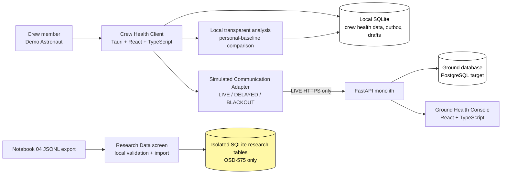
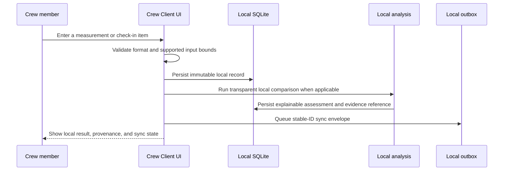
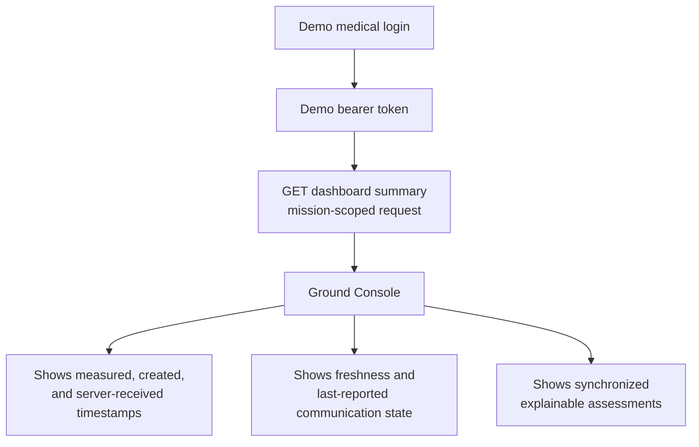
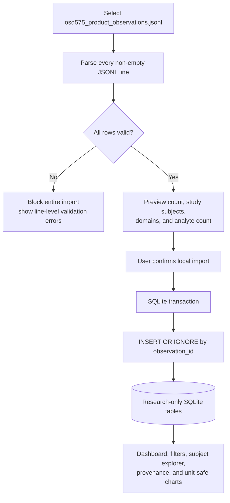
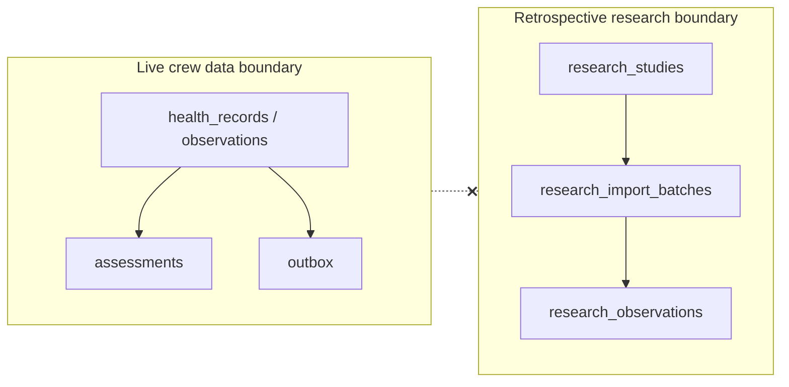

# Astronaut Health Monitoring & Decision-Support System

An offline-first health-monitoring demonstration with a local Crew Health Client, a Ground Health Console, and a simulated communication adapter. It is a hackathon prototype, not a medical diagnostic system, a flight-qualified system, or a NASA system.

**Specification version:** 0.3  
**Implementation status:** Crew Client, local SQLite persistence, baseline comparison, simulated synchronization, Ground Console retrieval, and isolated OSD-575 research-data import are implemented. See [Current implementation boundary](#current-implementation-boundary).  
**Research companion:** See [`docs/research/dataset-registry.md`](docs/research/dataset-registry.md) for candidate NASA and third-party datasets, rights, limitations, and approved-use warnings.

## Contents

- [What the system does](#what-the-system-does)
- [System architecture](#system-architecture)
- [Crew Health Client](#crew-health-client)
- [Ground Health Console and API](#ground-health-console-and-api)
- [Offline synchronization](#offline-synchronization)
- [Research Data: NASA OSD-575](#research-data-nasa-osd-575)
- [Storage and data boundaries](#storage-and-data-boundaries)
- [Run locally](#run-locally)
- [Test and build](#test-and-build)
- [Safety and limitations](#safety-and-limitations)
- [v0.3 reference specification](#v03-reference-specification)

## What the system does

The Crew Health Client is a Tauri desktop application built with React and TypeScript. It remains usable in simulated `BLACKOUT`, stores health observations locally in SQLite, performs a transparent personal-baseline comparison for heart-rate data, creates explainable assessments, and queues crew-originated events for later delivery.

The Ground Health Console is a React web application backed by one FastAPI service. It is intended for an authorized demo medical user to inspect synchronized synthetic crew records, their timestamps, data freshness, assessment summaries, and last-reported communication state.

The client also has an isolated Research Data area for retrospective NASA OSD-575 reference records. It is intentionally separate from mission observations: study subjects are never mapped to crew astronauts, relative study timepoints are never converted to UTC, and imported research records never produce crew alerts or medical conclusions.

## System architecture



The adapter is simulated. The project does not connect to NASA TDRS, DSN, spacecraft systems, or NASA infrastructure.

### Repository layout

| Path | Purpose |
|---|---|
| `apps/crew-client` | Tauri desktop Crew Health Client and its local SQLite integration. |
| `apps/ground-console` | Browser-based Ground Health Console. |
| `services/api` | Single FastAPI backend for demo authentication, synchronization, and ground retrieval. |
| `openapi.yaml` | Versioned API contract/reference. |
| `schema.sql` | Ground-side logical schema reference. |
| `crew-local-schema.sql` | Crew SQLite logical schema reference. |
| `docs/research/dataset-registry.md` | Dataset provenance, licensing, scope, and limitations. |

## Crew Health Client

The Crew Health Client is local-first. The app opens its SQLite store before enabling demo login, so a database failure is visible instead of silently falling back to browser storage.

### Available sections

| Area | Current behavior |
|---|---|
| Mission Dashboard | Local observation and assessment summary, communication state, pending count, and local trend view. |
| Daily Check-in | Six-step draftable workflow covering cardiovascular, recovery, behavioural, symptoms, activity, and nutrition/hydration inputs. |
| Health modules | Local entry, history, empty states, and unit-safe trend charts for cardiovascular, behavioural, sleep/cognition, musculoskeletal, immune, radiation, and environment data. |
| Sleep & Cognition | Persists reaction-time responses, median response time, and premature-response count locally. |
| Analytics | Filters local records by health domain, measurement, and 7-day/30-day/mission-history window. |
| Baselines | Shows the seeded demo heart-rate baseline and its version. |
| Action Centre | Persists evidence-linked action lifecycle changes locally; it does not generate medical recommendations. |
| Synchronization & Settings | Controls simulated connection state and optional synthetic demo data. |
| Research Data | Imports and visualizes isolated retrospective OSD-575 research data. |

### Crew data lifecycle



The prototype rejects structurally implausible demo input (for example, a 60-hour sleep duration or 24 °C body temperature). Those bounds are data-quality checks, not clinical reference ranges or medical thresholds.

## Ground Health Console and API

The Ground Console uses the API only after a demo medical login. Its dashboard displays synchronized data separately from source-time, client-creation-time, and server-receipt-time concepts.



The backend remains one FastAPI application. No microservice, message broker, or direct spacecraft integration is introduced.

## Offline synchronization

The Crew Client persists events before attempting transmission. An event keeps a stable ID and payload hash. A ground acknowledgement is required before the matching local record is shown as synchronized.

```mermaid
stateDiagram-v2
    [*] --> BLACKOUT
    BLACKOUT: Local capture and analysis continue
    BLACKOUT: No network request is attempted
    BLACKOUT --> DELAYED: Adapter state changed
    DELAYED: Records remain queued
    DELAYED --> LIVE: Transmission permitted
    LIVE: Authenticate and push queued envelopes
    LIVE --> LIVE: Accepted or duplicate acknowledgement
    LIVE --> DELAYED: Request fails; records stay queued
    LIVE --> BLACKOUT: Route unavailable
```



| State | Collection and analysis | Network behavior |
|---|---|---|
| `BLACKOUT` | Fully local and available. | No network attempt. |
| `DELAYED` | Fully local and available. | Records remain queued. |
| `LIVE` | Fully local and available. | Attempts push; marks only acknowledged event IDs as synchronized. |

## Research Data: NASA OSD-575

The Research Data screen accepts the Notebook 04 `osd575_product_observations.jsonl` export and imports it only after all non-empty JSONL lines validate. It uses local SQLite tables `research_studies`, `research_import_batches`, and `research_observations`; it never writes to live `observations`, astronauts, missions, baselines, alerts, or the crew outbox.



### Research safeguards

- Screen label: **NASA OSD-575 research reference data**.
- `subject_id` remains a pseudonymous study subject; it is never assigned to an astronaut or mission.
- `timepoint_text` is shown exactly as supplied. Labels such as `L-3` and `R+194` are not turned into timestamps.
- The research explorer performs only descriptive `L-` versus `R+` grouping when a selected subject/metric has compatible units. It creates no threshold, diagnosis, score, recommendation, or alert.
- Each displayed record retains value/unit, assay details, sample ID, source version, source file/table/sheet/row/column, upstream record ID, and quality status.
- Re-imports are idempotent by `observation_id` and show inserted versus duplicate-skipped counts.

## Storage and data boundaries



Local SQLite is active. SQLCipher encryption and OS-protected key storage are design targets only and must not be described as implemented or verified. Local browser storage is not used as a persistence substitute.

## Run locally

Use three PowerShell terminals from the repository root:

```powershell
# Terminal 1 — backend
cd D:\Projects\TakeOFF\astronaut_health_spec_v0_2\astronaut_health_spec\services\api
python -m pip install -r requirements.txt
python -m uvicorn app.main:app --reload --port 8000
```

```powershell
# Terminal 2 — Ground Health Console website
cd D:\Projects\TakeOFF\astronaut_health_spec_v0_2\astronaut_health_spec
npm install
npm run dev --workspace=ground-health-console
```

```powershell
# Terminal 3 — Crew Health Client desktop app
cd D:\Projects\TakeOFF\astronaut_health_spec_v0_2\astronaut_health_spec\apps\crew-client
npx tauri dev
```

The Ground Console’s Vite URL is printed in Terminal 2, normally `http://localhost:5173`. Start the API before switching the Crew Client to `LIVE`.

## Test and build

```powershell
cd D:\Projects\TakeOFF\astronaut_health_spec_v0_2\astronaut_health_spec
npm run test:ui
npm run build --workspace=crew-health-client
npm run build --workspace=ground-health-console
```

```powershell
cd D:\Projects\TakeOFF\astronaut_health_spec_v0_2\astronaut_health_spec\services\api
python -m pytest -q
```

```powershell
cd D:\Projects\TakeOFF\astronaut_health_spec_v0_2\astronaut_health_spec\apps\crew-client\src-tauri
cargo build
```

## Safety and limitations

- All demo health entries and optional seeded records must remain visibly labelled as synthetic where applicable.
- The app compares a supported heart-rate observation against one configured demo personal baseline. It does not diagnose, medically clear, prescribe, or predict outcomes.
- No validated machine-learning model, flight hardware integration, live sensor integration, SQLCipher deployment, production authentication, or flight assurance is claimed.
- Ground communication is a local simulated HTTP path. It is not proof of spacecraft contact or an operational communications link.
- Dataset availability and usage rights remain subject to the limitations in the dataset registry.

---

These remain open because the sources describe capability and operating context, not implementation requirements for this independent prototype.
